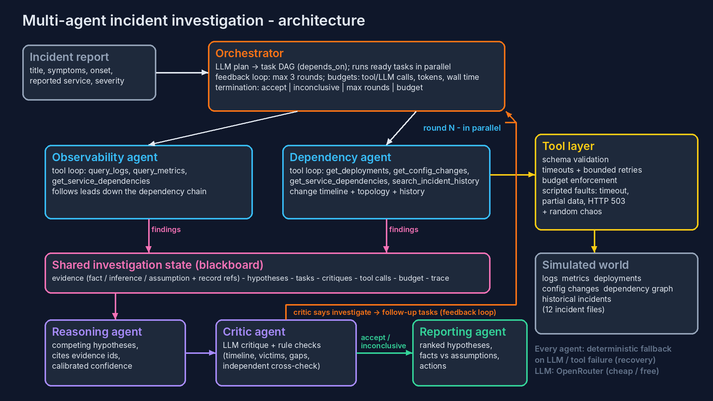

# Multi-Agent Production Incident Investigator

A multi-agent AI system that investigates production incidents, ranks competing root-cause hypotheses with
supporting and contradicting evidence, and recommends corrective actions. It is allowed to say "inconclusive".
It is evaluated against a single-agent baseline that uses the same tools, on 12 synthetic incidents built to be
misleading, contradictory and fault-ridden.

* **Language:** Python 3.10+, standard library only. `pytest` is the only dev dependency.
* **LLM:** any OpenRouter model. The default is the cheap `deepseek/deepseek-v4-flash` (about $0.09 per 1M input tokens), with a free fallback, `google/gemma-4-31b-it:free`.
* **No API key?** Everything still runs. In `offline` mode, every agent uses its deterministic fallback path (see [Recovery](#orchestration-and-reliability)).

**Walkthrough video (about 10 min):** [`video/walkthrough.mp4`](video/walkthrough.mp4). The narration script is in [`video/narration.md`](video/narration.md), and the video is rebuilt from the eval results by `python3 video/make_video.py`, which needs `pip install edge-tts`.
**Technical note:** [`docs/TECHNICAL_NOTE.md`](docs/TECHNICAL_NOTE.md)



---

## 1. Setup and running

```bash
cd incident-investigator
python3 -m pip install -r requirements.txt        # only pytest
cp .env.example .env                              # then put your OpenRouter key in .env (optional)

# investigate one incident (Markdown report on stdout)
python3 -m investigator.cli INC-002                       # multi-agent, LLM if OPENROUTER_API_KEY is set
python3 -m investigator.cli INC-002 --mode single         # single-agent baseline
python3 -m investigator.cli INC-007 --backend offline     # no LLM: deterministic fallbacks
python3 -m investigator.cli INC-010 --model openai/gpt-oss-20b --json

# full evaluation: multi-agent vs single-agent on all incidents
python3 eval/run_eval.py --backend offline
python3 eval/run_eval.py --backend openrouter --model deepseek/deepseek-v4-flash

# tests
python3 -m pytest -q

# regenerate the synthetic dataset / diagram
python3 scripts/generate_dataset.py
python3 scripts/draw_architecture.py
```

Environment variables (`.env` is loaded automatically): `OPENROUTER_API_KEY`, `OPENROUTER_MODEL`,
`OPENROUTER_FALLBACK_MODELS` (comma-separated), `LLM_BACKEND` (`openrouter` | `offline`), `TOOL_CHAOS_RATE`
(default `0.05`), `LLM_TIMEOUT_S`.

## 2. Repository layout

```
investigator/
  config.py            settings + limits (rounds, steps, budgets, timeouts, retries)
  llm.py               OpenRouter client (retries, model fallback, token accounting), Offline + Scripted LLMs, robust JSON parsing
  tools.py             6 tools over a simulated world, schema validation, fault injection, ToolExecutor (timeouts, retries, budget)
  state.py             shared blackboard: evidence, hypotheses, task DAG, critiques, tool calls, budget, trace
  heuristics.py        deterministic analytics: fallback path, offline engine, and the critic's independent cross-check
  agents/base.py       validated JSON LLM calls + bounded tool-use loop + evidence grounding
  agents/specialists.py  Observability and Dependency agents
  agents/analysts.py     Reasoning, Critic and Reporting agents
  agents/orchestrator.py Orchestrator: planning, DAG scheduler, feedback loop, termination
  baseline.py          single-agent baseline (same tools, budgets and report schema)
  report.py            JSON + Markdown report
data/incidents/        12 incident "worlds" (logs, metrics, deploys, config, dependency graph, history, fault profile)
data/ground_truth/     labels: read ONLY by the evaluator (a test enforces this)
eval/run_eval.py       metrics + comparison; results in eval/results/<backend-or-model>/
tests/test_system.py   21 automated tests
docs/                  architecture diagram, technical note
transcript/            coding-assistant transcript
video/                 walkthrough video + the script that builds it
```

## 3. Architecture and agent coordination

| Agent | Responsibility | Tools | Output on the blackboard |
|---|---|---|---|
| **Orchestrator** | Plans round 0 (LLM, validated, with a guaranteed-coverage fallback). Builds a task DAG, runs ready tasks concurrently, runs the feedback loop and enforces budgets and termination. | - | tasks, termination reason |
| **Observability** | Logs and metrics: when and how each service misbehaved. Follows leads (services named in errors, dependencies of anomalous services). | `query_logs`, `query_metrics`, `get_service_dependencies` | evidence |
| **Dependency** | Deployments, config/feature-flag changes, dependency topology, similar past incidents. | `get_deployments`, `get_config_changes`, `get_service_dependencies`, `search_incident_history` | evidence |
| **Reasoning** | Builds 1-4 *competing* hypotheses. Each cites evidence ids for and against, lists assumptions and gets a calibrated confidence. | - | hypotheses |
| **Critic** | Challenges the leading hypothesis with an LLM critique plus rule checks: effect before cause, victim vs cause, fewer than 2 facts, no separation between the top two, history-only support, unexplored downstream services, data gaps, and disagreement with an independent topology/timeline analysis. Returns `accept` / `investigate` (with targeted follow-up tasks) / `inconclusive`. | - | critiques, follow-up tasks |
| **Reporting** | Final summary, prioritised actions, open questions. | - | report |

**How they collaborate (not a prompt chain):**

1. **Shared state.** Every agent reads and writes a typed blackboard (`InvestigationState`). Specialists see the evidence and critic concerns that other agents produced; that context is in their prompt. The Reasoning agent can only cite evidence ids that exist on the board.
2. **Task DAG.** Each round is `[specialist tasks] -> reasoning -> critic`, with `depends_on` edges. Independent specialist tasks run in parallel (`asyncio.gather`), and agents may issue up to 4 parallel tool calls per step.
3. **Feedback loop.** When the critic returns `investigate`, its structured follow-ups (`{agent, goal, focus_services}`) become the next round's tasks. Example: *"check whether ['orders-db'] misbehaved before orders-service"*. Follow-ups that would only repeat completed work are dropped (stagnation guard). The loop is bounded at 3 rounds.
4. **Termination.** The loop ends when the critic accepts, the critic rules the incident inconclusive, max rounds is reached, the budget is nearly exhausted, a `BudgetExceeded` is raised, or a hard wall-clock timeout fires. A report is always produced. When the top confidence is below 0.45, the outcome is `inconclusive`.

### Evidence-based conclusions
* Evidence items are typed `fact` / `inference` / `assumption` and carry **dataset record ids** (`L-0042`, `M-orders-db-connections_active`, `D-001`, `C-001`, `H-001`).
* **Grounding check:** every cited id is checked against what tools actually returned. Invalid ids are dropped, and a "fact" with no valid id is **downgraded to an assumption** (counted in `grounding.facts_downgraded`).
* A hypothesis with no supporting evidence has its confidence capped at 0.2.
* The report lists ranked hypotheses with supporting and contradicting evidence, confidence, assumptions, separate *Facts* and *Inferences/assumptions* sections, prioritised actions and an investigation trace.

## 4. Tools and failure simulation

All tools take structured arguments, which are validated against a declared schema (types, enums, required keys), and return structured JSON. Errors come back as structured results, never raw exceptions: `not_found` and `invalid_argument` are non-retryable, while `timeout` and `backend_error` are retryable.

| Tool | Returns |
|---|---|
| `query_logs(service, level?, contains?, start?, end?, limit?)` | per-message counts with first/last seen and an example id, plus a sample of records |
| `query_metrics(service, metric?, start?, end?, include_points?)` | baseline vs recent mean, peak, change ratio, first anomaly timestamp |
| `get_deployments` / `get_config_changes(service?, start?, end?)` | change events |
| `get_service_dependencies(service \| "*", direction?)` | downstream/upstream edges |
| `search_incident_history(query, limit?)` | past post-mortems (flagged as "a lead, not proof") |

Failures: each incident can script `timeout` (the call hangs and the executor's timeout fires), `partial` (records truncated, recent metric points missing, `incomplete: true`) or `error` (HTTP 503). On top of that, random chaos (`TOOL_CHAOS_RATE`) adds transient faults. `ToolExecutor` applies the per-call timeout and bounded exponential-backoff retries (2), enforces the tool budget, and records every call.

## 5. Orchestration and reliability

| Requirement | Where |
|---|---|
| Parallel execution | `Orchestrator.run_dag` (concurrent ready tasks), `ToolExecutor.run_many` (parallel tool calls) |
| Shared state + task dependencies | `state.InvestigationState`, `Task.depends_on` |
| Feedback loops | critic `follow_ups` become next-round tasks (`Orchestrator.investigate`) |
| Bounded retries | tool retries (2, backoff), LLM JSON re-asks with the validation error (2), model fallback list in `OpenRouterClient` |
| Execution limits | `Limits`: 3 rounds, 5 steps per agent task, 70 tool calls, 45 LLM calls, 300k tokens, 420 s per investigation |
| Termination conditions | accept / inconclusive / max rounds / budget / hard timeout |
| Recovery from agent failure | any exception in an agent's LLM path makes it run its deterministic fallback with real tool calls (task status `recovered`). A failed DAG dependency does not block dependents. |
| Recovery from tool failure | retries, then the failure itself becomes evidence (`signal=tool_failure`). Observability widens the search to dependencies of services it cannot observe, and re-queries partial metrics. |

## 6. Synthetic dataset (12 incidents)

`scripts/generate_dataset.py` builds 15-service e-commerce worlds with background noise, a 7-hour window,
5-minute metrics and realistic logs.

| id | true cause | what makes it hard |
|---|---|---|
| INC-001 | deployment_bug @ payment-service | baseline sanity case |
| INC-002 | config_change @ orders-db (`max_connections` 500 to 50) | **misleading:** a frontend deploy lands right before the report |
| INC-003 | dependency_outage @ payment-gateway-ext | unrelated config change; **tool timeout** on the first metrics call |
| INC-004 | resource_exhaustion @ recommendation-service (slow leak) | **misleading:** fresh search deploy; the real change is 5 h old |
| INC-005 | traffic_spike @ api-gateway | harmless auth deploy 40 min earlier |
| INC-006 | certificate_expiry @ auth-service | **misleading history:** a near-identical past incident blames redis, and redis evictions really are up |
| INC-007 | config_change @ redis-cache (TTL 3600 s to 5 s) | **tool failure:** logs for search/redis/product-db always time out; metrics truncated |
| INC-008 | deployment_bug @ inventory-service (locking migration) | **conflicting:** search-service shows the loudest CPU symptom; deployments tool errors on the first call |
| INC-009 | none: **expected inconclusive** | weak signal, no changes, persistently incomplete metrics |
| INC-010 | config_change @ api-gateway (retry storm) | victim (user-service) has its own deploy; gateway traffic is flat |
| INC-011 | config_change @ notification-service (feature flag) | **misleading history** plus genuinely elevated redis evictions that started earlier |
| INC-012 | resource_exhaustion @ orders-db (disk full) | cascading failure, the loudest service is frontend; red-herring deploy; **truncated** log results |

## 7. Evaluation

`eval/run_eval.py` runs both systems on every incident and scores them:

* **Root-cause accuracy:** the top hypothesis has the correct service *and* an accepted cause type. For INC-009, the outcome must be `inconclusive`. The eval also reports service-only accuracy, cause-type accuracy, top-3 recall and *confident-wrong* answers (wrong but at least 0.6 confident).
* **Evidence grounding:** the share of cited evidence whose record ids all appear in successful tool results. **Key-evidence recall** is the share of the ground-truth key records that the report cites.
* **Cost:** tool calls, LLM calls, tokens, latency.

### Results: offline backend (deterministic fallback agents, no LLM)

These numbers are fully reproducible with no API key (`python3 eval/run_eval.py --backend offline`):

| metric | multi-agent | single-agent |
|---|---|---|
| root-cause accuracy | **12/12 (1.00)** | 7/12 (0.58) |
| top-3 recall | 1.00 | 0.67 |
| confident-wrong | 0 | 0 |
| evidence grounded | 1.00 | 1.00 |
| key-evidence recall | **0.92** | 0.42 |
| avg tool calls | 24.7 | 7.3 |
| avg latency | 0.53 s | 0.14 s |

The single agent fails on the cases built to punish one-pass investigation. In INC-002 and INC-012 it blames the loud frontend. In INC-003 it blames payment-service, which is the victim of the gateway outage. In INC-007 and INC-008 the root-cause service is never examined. The multi-agent system's critic flags unexplored downstream dependencies and missing mechanisms, and its follow-up rounds then find the real cause. The extra tool calls are the price.

**Caveat:** the deterministic heuristics were developed while looking at these same 12 incidents, so the offline numbers are an upper bound for that engine, not a held-out result. See the technical note.

### Results: LLM backend

Run `python3 eval/run_eval.py --backend openrouter --model <model>`. The results go to `eval/results/<model>/summary.md`, along with every report as `.md` and `.json`. **The LLM evaluation has not been run yet in this submission, because no OpenRouter key was available in the build environment.** The LLM code path is covered by tests that use a scripted model (grounding, downgrading fabricated facts, recovery from invalid output), and it was smoke-tested against the OpenRouter API schema. Add a key and run the command above to produce the live comparison.

## 8. Incomplete functionality and external dependencies

* **External:** OpenRouter (optional). Free models are rate-limited, about 50 requests a day without credits, and a full eval needs about 300-400 calls, so use a cheap paid model (a full run costs well under $0.50).
* Native function-calling is not used. Agents use a JSON action protocol so that any OpenRouter model works, including free ones without tool support.
* The tools run over a simulated world, not real Loki/Prometheus/Kubernetes APIs. Swapping in real backends means reimplementing the `ToolBox` methods.
* Confidence is calibrated only heuristically (LLM self-report plus caps and normalisation). There is no learned calibration.
* The dataset is small (12 incidents) and authored by the same person as the heuristics.
* There is no UI, by design. The reports are Markdown/JSON.

## 9. AI coding assistant transcript

The system was built with Claude Code. The transcript is in [`transcript/`](transcript/).
